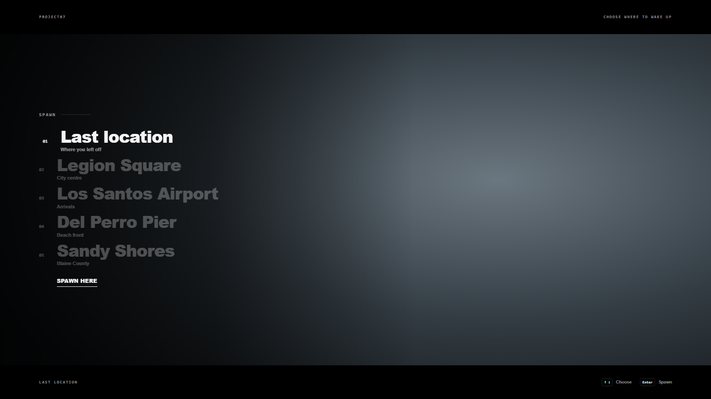

# Project07_FreeSpawn

Free spawn selector for Qbox. A clean text list on the left, an aerial camera flies over each place. No admin panel, places are in `config.lua`.

## Features
- "Last location" first (when the character has one), then the character's owned properties, then your own places.
- New characters on **qbx_properties** pick a starting apartment (it puts them inside and opens the clothing menu); other new characters get the clothing menu after spawning.
- Housing through Project7H_Lib: qbx_properties, ps-housing, qb-houses (`Config.housing`, `Config.properties`).
- ↑ ↓ to pick, Enter to spawn.
- The client only sends the place name; the server answers with the coordinates.
- Discord log of every spawn.

## Requirements
- [qbx_core](https://github.com/Qbox-project/qbx_core)
- [ox_lib](https://github.com/overextended/ox_lib)
- [Project7H_Lib](https://github.com/PehesaraNimnad/Project7H_Lib/releases/latest) (framework / appearance / weather / spawn layer)

## Installation
1. Put `Project07_FreeSpawn` in your `resources` folder.
2. Add to `server.cfg` after the requirements:
   ```
   ensure Project07_FreeSpawn
   ```
3. Edit the places in `config.lua` (`label`, `sub`, `coords = vec4(x, y, z, heading)`).
4. Optional: Discord webhook in `sv_config.lua`.

A multicharacter opens it with the export `exports.Project07_FreeSpawn:ShowMenu(isNewCharacter)` (Project07_FreeMultichar does this by itself). Do not run it together with another spawn selector.

## Building the UI (only if you change it)
```
cd web
npm install
npx vite build --mode spawn
```
Copy `build/spawn` to `web/build`.

## Preview


